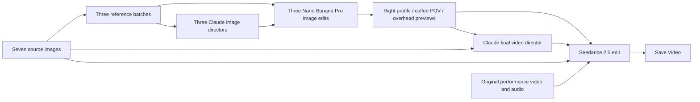

# ComfyUI MultiShot Workflow (Coffee Example Included)

Change a single view video into a cinematic sequence using image guided camera references. Claude refines shot instructions, Nano Banana Pro generates three alternate views, and Seedance 2.5 edits the original video using those views plus the original character and prop references.

This is an MIT licensed **ComfyUI workflow**, with optional App Mode inputs and outputs. The partner models run remotely and use the signed in user’s Comfy credits. Their model weights are not included or open sourced by this project. This repository does not contain a custom Python node package or a separate web application.

## Requirements: no dedicated GPU needed for AI generation

**This workflow runs Claude, Nano Banana Pro and Seedance remotely through paid partner nodes. It does not require a dedicated local GPU for AI generation, local model downloads or a rented Runpod GPU instance.** See [how partner nodes work](https://docs.comfy.org/tutorials/partner-nodes/overview).

## Requirements
* **Software:** a compatible, updated ComfyUI installation with the official partner nodes and ComfyUI-KJNodes for `ImageBatchMulti`.
* **Memory:** ComfyUI Desktop lists 8 GB RAM as its minimum and recommends 16 GB. These are Desktop requirements, not a measured minimum for this workflow.
* **Storage:** allow space for ComfyUI, its dependencies, the example media and generated outputs. Desktop lists at least 4.85 GB per standalone installation, before additional assets and outputs.
* **Connectivity:** an internet connection for the hosted models and media transfers.
* **Account and credits:** a signed in Comfy account with sufficient credits for the partner calls. Using partner nodes locally does not require a Comfy Cloud subscription. This workflow uses approximately 1600-2000 Comfy credits.

See the current [Desktop requirements](https://docs.comfy.org/installation/desktop/overview) for supported operating systems and installation details.

**CPU execution has not yet been tested with this exact workflow.** On a machine without a supported GPU, ComfyUI may need to be configured to run on the CPU. The workflow is expected to work without a dedicated GPU based on its nodes, but this is not a verified compatibility claim for every Desktop installation.

## Start here

1. Follow [Desktop setup and credits](docs/SETUP.md).
2. Locate the included seven reference images and original video in `coffeeExample/`, as listed in the [asset guide](assets/README.md).
3. Drag [ComfyUIMultiShotWorkflowCoffeeExample.json](ComfyUIMultiShotWorkflowCoffeeExample.json) from this repository's root into ComfyUI.
4. Select the media in each loader, review the Director prompts, and run the workflow.

Use the root JSON for the prepared submission. The [original export](originals/ComfyUIMultiShotWorkflowCoffeeExample.json) retains its original generation graph for comparison, with setup notes added and still contains account specific filenames and empty image director prompts.

## Create a Comfy account and add credits

1. Install and launch [ComfyUI Desktop](https://docs.comfy.org/installation/desktop/overview), or open your existing Comfy Cloud workspace.
2. Open **Settings → User**. If you do not have a Comfy account, choose the account creation option in the sign in flow. Complete registration using email or an available Google or GitHub option, then sign in to ComfyUI.
3. Open **Settings → Workspace → Plan & Credits**. This panel appears after signing in. On Cloud, you can also reach it through your profile menu and **Manage plan**.
4. Choose the amount of credits to purchase, select **Buy**, review the amount and complete checkout. Use the same email as your Comfy account.
5. Return to **Plan & Credits** and confirm that the balance has updated. Refresh or restart if needed.
6. Before running, inspect the price badges on the Claude, Nano Banana Pro and Seedance partner nodes. Each execution uses your account's credits. Keep an internet connection available.

Desktop partner nodes can use purchased credits without a Cloud subscription. Running on Comfy Cloud requires a Cloud plan as well. See the official [account guide](https://docs.comfy.org/interface/user) and [credits guide](https://docs.comfy.org/interface/credits).

## Set up the coffee clip workflow

### Open the prepared graph

1. Download and extract this repository, including the `coffeeExample/` folder.
2. In Desktop, open ComfyUI Manager, install **ComfyUI-KJNodes** for `ImageBatchMulti`, and restart ComfyUI. On Cloud, confirm that this dependency is available in your workspace.
3. Drag the root **ComfyUIMultiShotWorkflowCoffeeExample.json** into the ComfyUI graph. Use the file at the repository root rather than the archival version under `originals/`.
4. Locate the Load Image and Load Video nodes. In each one, use the file chooser or upload button to select the file listed below. If a node already shows the correct file and preview, it is already loaded. Keep its existing connections.

The numbered prefixes in the main graph's loader titles match the node IDs below. Each listed path is relative to this repository. JSON contains filenames and settings, so the media must still be uploaded or available in the ComfyUI input directory.

### Upload the video and seven images

1. **Original performance video, node 6:** in **Load Video**, choose `coffeeExample/CoffeeDrinkLandscape.mp4`. This is the source performance with audio. Its VIDEO output is already connected to Seedance's **Video 1** input.
2. **Original character identity and wardrobe, node 1:** in **Load Image**, choose `coffeeExample/coffeeCharacterReference.png`. It supplies the subject's identity and clothing. It also feeds Seedance's **Image 1** input.
3. **Original mug design and proportions, node 7:** choose `coffeeExample/coffeCupProp.jpeg`. It supplies the mug design and feeds Seedance's **Image 2** input. Keep the filename's spelling exactly as shown.
4. **Environment visible from a right side camera, node 10:** choose `coffeeExample/subjectRightView.png`. This is the environment reference for generating the right profile shot, not the generated profile image.
5. **Drinking pose and right hand grip, node 14:** choose `coffeeExample/forCoffeeCupShot.png`. It provides the pose and cup grip for the coffee POV image.
6. **Environment seen from the subject looking forward, node 18:** choose `coffeeExample/subjectForwardView.png`. It provides the background for the coffee POV image.
7. **Overhead chair, table and floor reference, node 19:** choose `coffeeExample/subjectTopView.png`. It provides the room geometry for the overhead image.
8. **Subject looking up, node 21:** choose `coffeeExample/forAboveShot.png`. It provides the upward gaze, head tilt and hand positions for the overhead image.

After each upload, wait for the preview and check that the selected filename matches. If you prefer copying files rather than uploading them individually, copy the repository's `coffeeExample/` folder into `<ComfyUI>/input/coffeeExample/`. The prepared JSON already references that relative folder.

## Run the coffee example and save the result

1. Check all eight loader previews against the filenames above. Keep the existing wires, prompts, model selections and generation settings. Selecting files or changing local paths is permitted for the supplied example media.
2. Confirm the partner nodes show the saved models: **Opus 5.5**, **Nano Banana Pro** and **Seedance 2.5**. If nodes or models are missing, update ComfyUI and resolve the dependency before running.
3. Press **Run**. A full uncached run makes four Claude calls, three Nano Banana image calls and one Seedance video call. The previews do not pause the workflow for approval.
4. Inspect the generated images in **Preview Right profile (12)**, **Preview Coffee POV (17)** and **Preview Overhead (23)**. The graph automatically sends these to Seedance as **Image 3**, **Image 4** and **Image 5**, respectively. Leave **Image 6** empty.
5. Review the final video in **Save Video (24)** and listen to its audio. The prompt requests the original audio, but the graph does not enforce an exact audio copy.
6. Download the final video from the output controls. On Desktop it is also saved under the ComfyUI output location with the `video/ComfyUI` prefix. Download the three shot images from their preview menus if needed.

You do not need to upload `ComfyRightProfile.png`, `ComfyCoffeePOV.png` or `ComfyAbovePOv.png` to run the main workflow. Those files are example results. The connected Nano Banana nodes generate fresh shot images. The other extra images in `coffeeExample/` are not required for this graph.

The supplied media may only be used to test and demonstrate the provided unchanged workflow. See `assets/MEDIA_LICENSE.md` in the repository. Use your own appropriately licensed media for workflow modifications.

## What happens

The planned sequence runs approximately 18 seconds: original framing, coffee POV, a crane move, overhead view, and right profile. Three generated references support five planned shot segments. The actual cut timing, identity fidelity and audio preservation remain subject to the video model's behavior.

* [Workflow and node map](docs/WORKFLOW.md)
* [Copyable prompts for every generation stage](docs/PROMPTS.md)
* [Submission checklist, demo outline and social draft](docs/SUBMISSION.md)
* [Validation status](docs/VALIDATION.md)

## Demo and links

| Item | URL/status |
| --- | --- |
| GitHub repository | ADD_PUBLIC_REPOSITORY_URL |
| Demo, no longer than two minutes | ADD_DEMO_URL |
| Final output / social post | ADD_SOCIAL_POST_URL |
| Optional longer tutorial | ADD_TUTORIAL_URL |
| Optional Comfy Cloud App Mode link to try the workflow | ADD_TRY_IT_URL |

The source images and reference video are included in [coffeeExample](coffeeExample/). Public links and a fresh ComfyUI test remain pending.

## Dependencies and cost

Use an updated ComfyUI runtime and frontend with the official Claude, Nano Banana Pro and Seedance partner nodes. Install [KJNodes](https://github.com/kijai/ComfyUI-KJNodes) for `ImageBatchMulti`. No local diffusion or LLM model downloads are required for this graph.

A full uncached run has four Claude calls, three image generation calls and one video generation call. Check the node prices and account balance before running. Retries and regeneration may incur additional charges. This workflow does not pause automatically for approval between stages.

## License and attribution

[MIT](LICENSE) covers this project's workflow JSON, documentation and helper script. ComfyUI, KJNodes and hosted model services retain their own licenses and terms. The supplied images and reference video may be used only to test and demonstrate the provided unchanged workflow, subject to the [media permission statement](assets/MEDIA_LICENSE.md). File selection and local path changes needed to load them are allowed. The MIT license does not cover these media files. Workflow modifications remain permitted under MIT when using your own appropriately licensed media.

Built for [Open Source Higgsfield](https://comfy.org/open-source-higgsfield/). This partner model workflow is not an entry for the Open Weights Only bonus.
